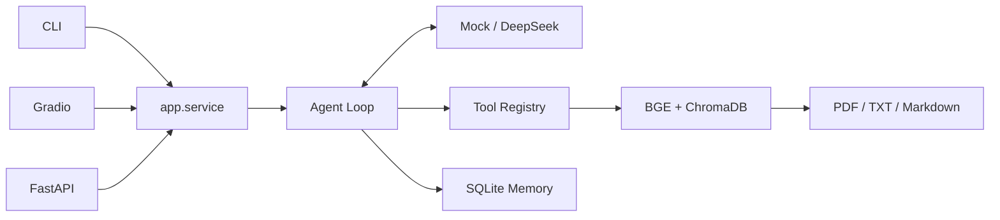
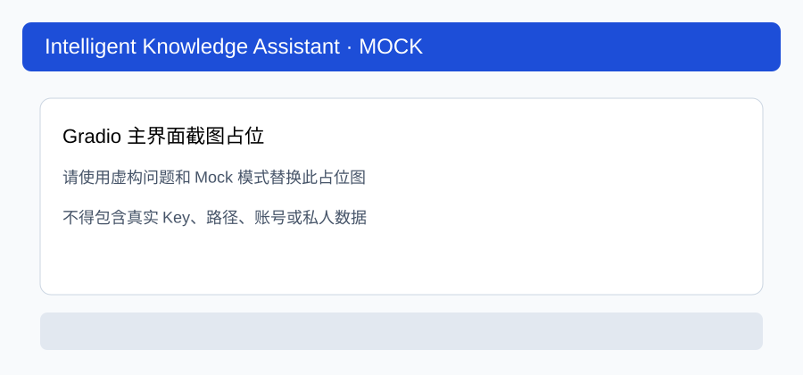
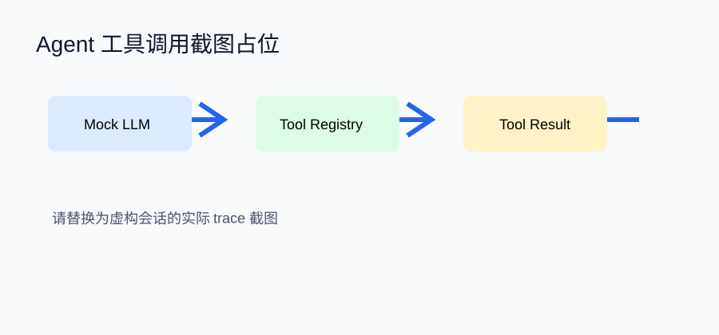
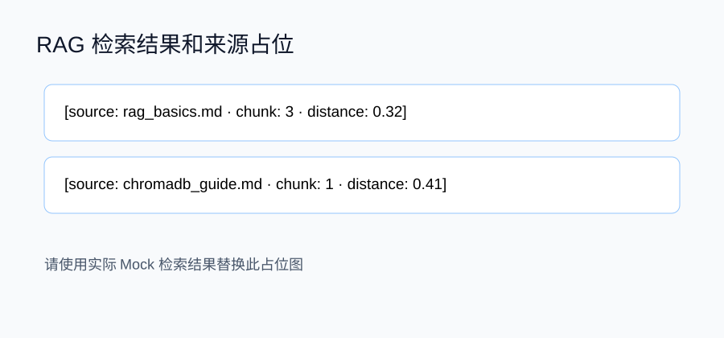
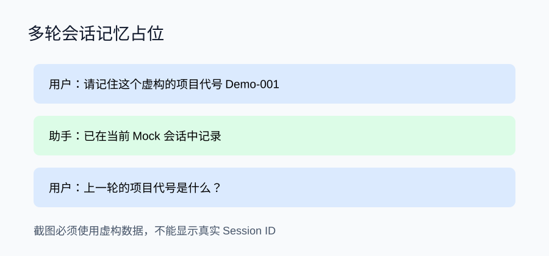

# Intelligent Knowledge Assistant

一个面向工程实践的智能知识助手：基于 OpenAI 兼容 LLM API、手写 Agent/Function Calling、SQLite Memory、BGE、ChromaDB、FastAPI 和 Gradio。默认使用完全离线的 Mock LLM，未配置余额也能验证完整业务闭环。

> 本项目基于 [Acaposa/agent-demo](https://github.com/Acaposa/agent-demo) 继续开发，保留原 MIT License 与作者署名，不宣称原始代码为本项目维护者独立原创。

## My Contributions（二次开发）

本仓库是在 Acaposa/agent-demo 基础上的二次开发，以下区分原项目基础与本次实际整理/扩展的工作，避免把上游代码描述为完全原创。

| 范围 | 原项目基础（保留/整理） | 本次二次开发与完善 |
|---|---|---|
| Agent | 基础 Agent 循环、城市/天气类工具和 Function Calling 思路 | 模块化 `agent/` 结构、工具注册表/Schema 校验、JSON 错误处理、重试/超时、重复调用保护、危险工具拦截、调用轨迹和 Mock 闭环测试 |
| LLM | OpenAI 兼容的 DeepSeek 调用方向 | 默认离线 Mock、显式 API/Mock 切换、超时/有限重试、Key 缺失提示和安全边界 |
| RAG | 原始项目的知识助手方向与文档检索基础 | BGE + Chroma 持久化、PDF/TXT/Markdown、页码/来源元数据、增量索引、重复/更新/删除、白名单语料和双语术语扩展评估 |
| Memory/API/UI | 原有 CLI/应用基础 | SQLite 多会话恢复与摘要、共享 service 层、FastAPI 安全边界、Gradio 上传/会话/工具轨迹界面 |
| 工程化 | 原项目代码与 MIT 许可证 | 60 项测试、发布安全审计、公开/本地资料分离、架构/评估/面试文档和可复现启动流程 |

上表描述的是当前仓库中可核验的增量工作；原作者的实现、许可证和署名继续保留。

## 功能

- Agent 主循环、工具 Schema/注册表、参数校验、超时、重试、轨迹和死循环保护。
- PDF/TXT/Markdown 解析、BGE 512 维向量、Chroma 持久化、Top-K/阈值过滤。
- 面向中文语料的离线双语术语扩展，并保留优化前后 RAG 指标。
- 增量索引、重复文件识别、文档更新/删除、PDF 页码与来源追踪。
- SQLite 多会话隔离、历史恢复、清空/删除、滚动摘要。
- 离线 Mock 与 DeepSeek API 两种模式，Mock 输出有明确标识。
- Gradio 聊天/会话/安全上传/来源/工具轨迹和渐进式回答界面。
- FastAPI 健康、聊天、会话、上传、检索、知识库和工具接口，含上传限制、可选认证、限流和本地 CORS。

## 架构



技术栈：Python 3.10、OpenAI SDK、FastAPI、Gradio、ChromaDB、Sentence Transformers、BGE-small-zh-v1.5、SQLite、pytest。

## 目录

```text
agent/       Agent、LLM、RAG、Memory、Tools
app/         共享服务层、FastAPI、Gradio
scripts/     索引与评估脚本
tests/       单元与集成测试
docs/        公开工程文档和示例知识库
docs/assets/ 公开演示素材（SVG 占位图或隐私复核截图）
local_only/  本地学习资料（Git 忽略）
models/      本地模型（Git 忽略）
chroma_db/   向量库（Git 忽略）
```

## 安装

已有 Python 3.10 环境：

```powershell
python -m venv .venv
.\.venv\Scripts\Activate.ps1
python -m pip install -r requirements.txt
Copy-Item .env.example .env
```

Conda 新环境（仅适用于新电脑；已有可用环境无需重建）：

```powershell
conda create -n intelligent-knowledge-assistant python=3.10 -y
conda activate intelligent-knowledge-assistant
python -m pip install -r requirements.txt
Copy-Item .env.example .env
```

下载 `BAAI/bge-small-zh-v1.5` 到本地 `models/bge-small-zh-v1.5`，或通过 `EMBEDDING_MODEL_PATH` 指向已有模型。模型不随 Git 仓库发布；当前 Windows 工作区若发布目录旁存在原开发目录的 `models/bge-small-zh-v1.5`，配置会自动回退复用该模型，不需要复制模型或临时设置环境变量。新电脑请按 [安装指南](docs/INSTALLATION.md) 显式准备本地模型。

## 配置与运行

Mock 是默认且推荐的开发模式，不访问付费 API：

```powershell
$env:LLM_MODE='mock'
python main.py "RAG 是什么？"
python -m app.gradio_app
python -m uvicorn app.api:app --host 127.0.0.1 --port 8000
```

Gradio：`http://127.0.0.1:7860`；API 文档：`http://127.0.0.1:8000/docs`。

真实模式仅在用户主动设置 `LLM_MODE=api` 并在本地 `.env` 配置 Key 后启用：

```dotenv
# This block belongs in the local, Git-ignored .env file only.
LLM_MODE=api
LLM_BASE_URL=https://api.deepseek.com
LLM_MODEL=deepseek-chat
DEEPSEEK_API_KEY=<set-your-real-key-only-in-local-.env>
```

在本地 `.env` 中设置 `DEEPSEEK_API_KEY`，不要把真实值写入 README、日志或测试。缺少 Key 时 API 模式会明确失败；本次验收没有调用真实 DeepSeek API。

开发和验收默认使用：

```dotenv
LLM_MODE=mock
```

Mock 模式不读取 Key、不访问 DeepSeek、不产生付费请求。其他可选本地配置见 [.env.example](.env.example)。

CLI 也支持持久化会话：

```powershell
python main.py --session demo-001 "RAG 是什么？"
```

## 知识库与测试

```powershell
python -m scripts.rebuild_index
python -m pytest -q
python -m scripts.evaluate_rag --output docs/RAG_EVALUATION_REPORT.md
```

也可通过 `POST /rag/search` 进行结构化检索；Gradio 上传会进入同一增量索引流程，来源和距离会展示在工具轨迹中。

### 预置知识库

默认只索引以下三个白名单文档，避免把公开工程文档误加入知识库：

- `docs/rag_basics.md`
- `docs/function_calling.md`
- `docs/chromadb_guide.md`

首次部署且不存在有效索引时，从项目根目录执行：

```powershell
python -m scripts.rebuild_index
```

这是全量重建命令，会替换 `chroma_db/` 中的 `docs` 集合；已有正常索引时不要重复执行。日常用户文档导入请启动 Gradio，在“导入 PDF / TXT / Markdown”处选择文件并点击“构建知识库”；上传文件会进入被 Git 忽略的 `data/uploads/`。也可通过 FastAPI `POST /knowledge/upload` 上传，再使用 `POST /rag/search` 检索。

当前验收为 60 项自动化测试通过；既有知识库由 3 个明确白名单文档组成，共 72 条索引。8 条固定弱标注集上，纯向量基线 Recall@3 / Precision@3 / MRR 为 0.857 / 0.857 / 0.857，离线双语术语扩展后为 1.000 / 1.000 / 1.000。该结果仅代表项目内小型文档级标注集，逐题距离与限制见 [RAG 评估](docs/RAG_EVALUATION_REPORT.md)。强制重建会替换集合，日常应使用增量同步。

## 功能演示

1. 启动 Gradio，页面显示 `MOCK`。
2. 上传 PDF/TXT/Markdown 并点击“构建知识库”。
3. 提问文档内容，回答展示真实检索来源和工具轨迹。
4. 新建、加载或清空会话，验证历史持久化。

### 演示截图位置

截图只应使用虚构会话和无敏感信息的示例文档；将人工复核后的图片放入 `docs/assets/`：

| 场景 | README 预留位置 |
|---|---|
| Gradio 主界面 |  |
| Agent 工具调用 |  |
| RAG 检索结果和来源 |  |
| 多轮会话记忆 |  |

截图采集规范见 [DEMO_GUIDE.md](docs/DEMO_GUIDE.md)。图片尚未自动生成，避免把本机路径、用户名或会话信息误发布。

## 限制与路线图

- 文本型 PDF 可直接解析；扫描 PDF 尚未集成 OCR。
- 天气工具依赖外网，离线环境可能失败。
- DeepSeek 真实调用因账户无余额而未验证，不能把 Mock 结果视为真实模型结果。
- 后续可增加 OCR、BM25 混合检索和重排序。当前 Gradio 在 Agent 完成后渐进渲染文本，不等同于模型原生首 Token 流式链路。

更多文档：[完整架构与流程](docs/ARCHITECTURE.md) · [项目展示与简历](docs/PROJECT_SHOWCASE.md) · [面试问答](docs/INTERVIEW_GUIDE.md) · [演示与截图](docs/DEMO_GUIDE.md) · [RAG](docs/RAG_GUIDE.md) · [Agent](docs/AGENT_GUIDE.md) · [Memory](docs/MEMORY_GUIDE.md) · [Gradio](docs/GRADIO_GUIDE.md) · [API](docs/API_REFERENCE.md) · [使用](docs/USAGE.md) · [发布检查](docs/GITHUB_RELEASE_CHECKLIST.md)

## License

MIT License。原始许可证中的 `Copyright (c) 2026 Acaposa` 已完整保留。
