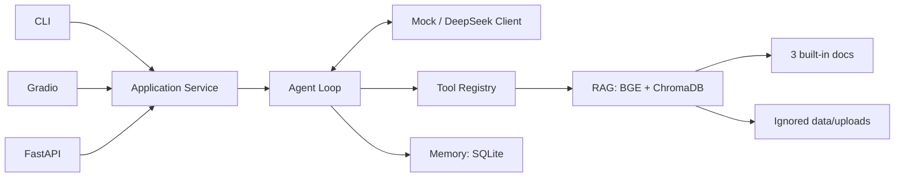
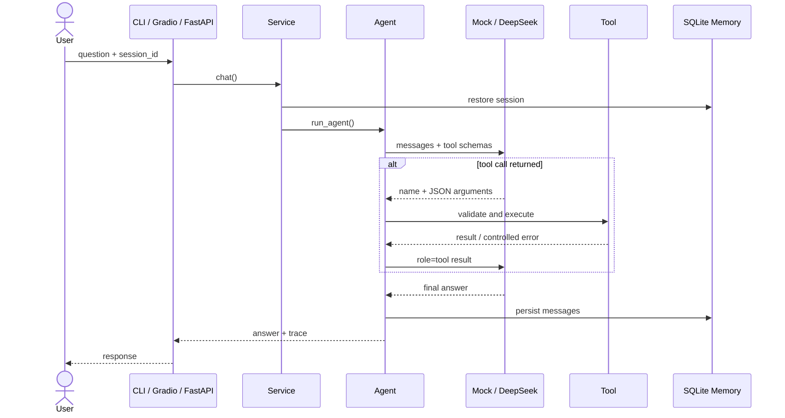
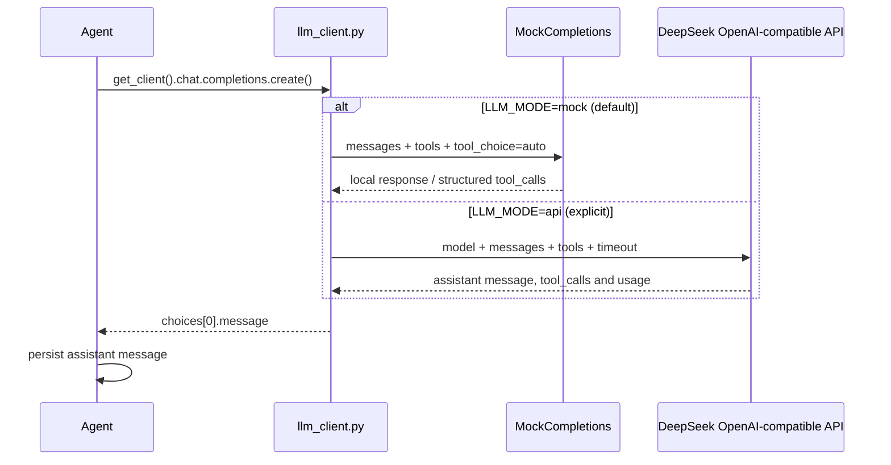
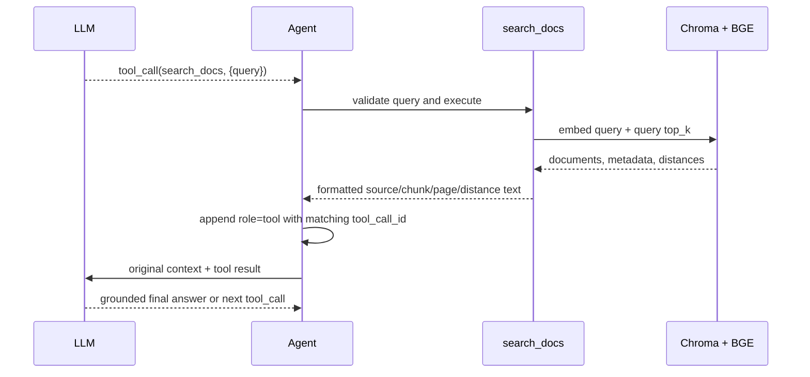
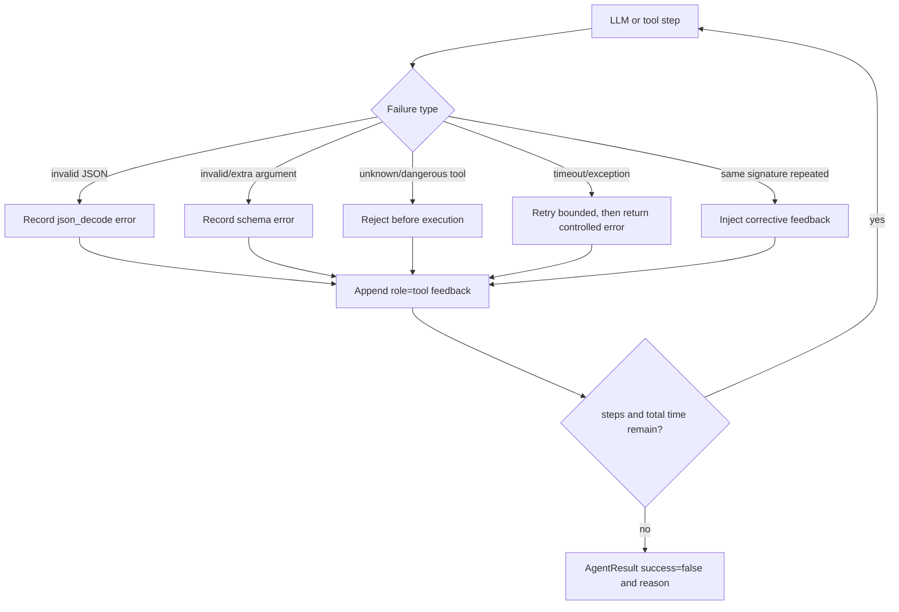
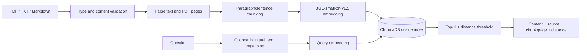

# Architecture

入口不包含核心业务；`app.service` 统一编排。Agent 只依赖客户端、工具与会话接口。RAG 使用本地 BGE 生成 512 维向量，并通过 Chroma 持久化。公开 `docs/` 中只有 3 个显式白名单文件进入知识库，工程文档不会被误索引；用户上传进入 Git 忽略的 `data/uploads/`。

FastAPI 边界包含大小/内容/文件名验证、本地 CORS、可选 Bearer Token、内存限流和异常脱敏。认证与限流面向单机演示；多进程生产部署应改用反向代理或共享限流存储。所有路径由 `agent.config` 基于项目根目录计算，兼容 Windows。

## Module responsibilities

| Module | Responsibility |
|---|---|
| `agent/config.py` | Relative paths, environment variables and runtime limits |
| `agent/llm_client.py` | Offline Mock and OpenAI-compatible DeepSeek client |
| `agent/loop.py` | Multi-step Agent orchestration and tool result feedback |
| `agent/tools.py` | Tool schemas, validation, registry, timeout and retry |
| `agent/rag.py` | Parsing, chunking, embedding, indexing and retrieval |
| `agent/memory.py` / `session_store.py` | In-memory context, summaries and SQLite persistence |
| `app/service.py` | UI/API-independent use cases |
| `app/api.py` | Validated and hardened HTTP boundary |
| `app/gradio_app.py` | Local interactive demonstration UI |

## Core request flow

## LLM API request and response

The request includes the system prompt, current session messages, registered tool schemas and automatic tool choice. A normal response has `message.content` and no tool calls. A tool response has `message.tool_calls[]`, where each item contains a call ID, function name and JSON arguments. API errors are caught by the Agent boundary; Mock mode never makes a network request and API mode is never enabled implicitly.

## RAG result into Agent context

The tool result is bounded by `MAX_TOOL_RESULT_CHARS`; source, chunk/page and distance remain visible to the model and the UI trace. If no result passes the distance threshold, the explicit “没有找到足够相关的文档内容” result is returned, allowing the model to state the limitation rather than inventing a citation.

## Failure and exception path

FastAPI converts failed service results to safe HTTP responses; unhandled exceptions are logged locally and redacted to clients. The UI displays a user-readable error and keeps the session trace. No failure branch prints API keys or local absolute paths.

## RAG flow

## Data boundaries

- Public sample corpus: three explicitly allowlisted Markdown files.
- Local uploads: `data/uploads/`, ignored by Git.
- Runtime state: `chroma_db/`, SQLite databases and `logs/`, ignored by Git.
- Private notes/reports: `local_only/`, ignored by Git.
- Secrets: `.env`, ignored by Git; `.env.example` contains placeholders only.
